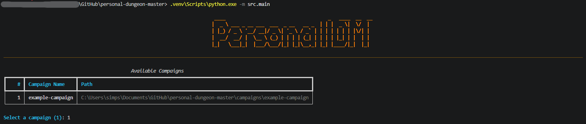
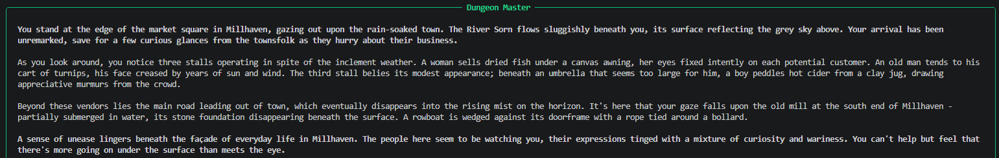

# Personal Dungeon Master


An AI-powered Dungeon Master that reads your campaign files and guides you through a tabletop RPG adventure — narrating scenes, voicing NPCs, rolling dice, and remembering everything that happens. Play by text, in the browser, or by voice.

Runs **entirely locally**. No API keys, no cloud calls, no data leaving your machine. The LLM backend is any OpenAI-compatible local inference server ([llama.cpp](https://github.com/ggerganov/llama.cpp), [LM Studio](https://lmstudio.ai/), or [Ollama](https://ollama.com/)).

[](https://github.com/danielbsimpson/personal-dungeon-master/actions/workflows/ci.yml)
[](LICENSE)
[](https://www.python.org/)

---

## Features

- **AI Dungeon Master** — an LLM narrates, voices NPCs, and adjudicates actions in natural language.
- **Full 5e rules** — grounded in the D&D 5e SRD; applies combat, spellcasting, checks, and conditions correctly.
- **Integrated dice engine** — the DM emits `[ROLL: ...]` tags that are intercepted and resolved by a real RNG; every roll is shown before narration.
- **Persistent memory** — a [Graphiti](https://github.com/getzep/graphiti) temporal knowledge graph on [Kuzu](https://kuzudb.com/) (embedded, no server) remembers entities, relationships, and events across sessions.
- **Spoiler protection** — the DM only surfaces campaign content up to the player's current position.
- **Semantic RAG pipeline** — campaign text is semantically chunked, hierarchically indexed, and retrieved via BM25 + embedding fusion, with contextual compression, RAPTOR summaries, and MemoRAG clues.
- **Six DM personalities** — The Sage, The Chronicler, The Bard, The Tactician, The Warden, The Mentor; switchable mid-session with `/personality`.
- **Multi-character parties** — run several characters from one `character.md`; switch with `/party` or attribute a line with `Name:`.
- **Three interfaces** — a streaming terminal chat, a FastAPI web UI with a Three.js DM avatar, and a voice mode (speech-to-text + text-to-speech).

---

## Screenshots

| Campaign selection | DM narration |
|---|---|
|  |  |

---

## Getting Started

### Prerequisites

- Python 3.11+
- A **local LLM server** exposing an OpenAI-compatible API (`/v1/chat/completions` and `/v1/embeddings`), such as [llama.cpp](https://github.com/ggerganov/llama.cpp/tree/master/examples/server), [LM Studio](https://lmstudio.ai/), or [Ollama](https://ollama.com/).
- A **chat model** with strong tool-calling for memory extraction (`llama3.1:8b`, `qwen2.5:7b`, or `mistral-nemo`) and an **embedding model** (`nomic-embed-text`).
- A GPU with 6 GB+ VRAM is recommended for 8B models; CPU-only inference works but is slower.

### Installation

```bash
git clone https://github.com/danielbsimpson/personal-dungeon-master.git
cd personal-dungeon-master
python -m venv .venv
.venv\Scripts\activate       # Windows
# source .venv/bin/activate  # macOS/Linux
pip install -r requirements.txt
```

### Configuration

Copy the example environment file and adjust it for your backend:

```bash
cp .env.example .env
```

```env
LLM_PROVIDER=llamacpp
LLAMACPP_BASE_URL=http://localhost:8080
DM_MODEL=llama3.1:8b        # leave blank to pick a model interactively
EMBEDDING_MODEL=nomic-embed-text
EMBEDDING_DIM=768
GAME_EDITION=5e
SESSION_WINDOW=20
```

> [!NOTE]
> Using Ollama? Set `LLAMACPP_BASE_URL=http://localhost:11434` and run `ollama pull llama3.1:8b` and `ollama pull nomic-embed-text`.

Start your local server before launching. For llama.cpp:

```bash
llama-server --model path/to/llama3.1-8b.gguf --port 8080
```

Windows users can edit and run [start_llama_server.bat](start_llama_server.bat).

### Running

```bash
python -m src.main                     # terminal chat
python -m src.main --interface web     # browser UI on http://localhost:8000
python -m src.main --voice             # voice mode (see below)
```

You'll be prompted to select a campaign and a DM personality, then the adventure begins.

| Flag | Description |
|---|---|
| `--campaign, -c NAME` | Load a named campaign directly, skipping the menu |
| `--model, -m MODEL` | Override `DM_MODEL` |
| `--edition, -e EDITION` | Override `GAME_EDITION` |
| `--interface, -i MODE` | `cli` (default) or `web` |
| `--voice` | Launch the CLI in voice mode |
| `--host` / `--port, -p` | Bind address for web mode |
| `--reset` | Wipe the session window before starting (graph preserved) |

### Voice mode

Voice adds local speech-to-text ([faster-whisper](https://github.com/SYSTRAN/faster-whisper)) and text-to-speech ([Kokoro](https://github.com/hexgrad/kokoro)):

```bash
pip install -r requirements-voice.txt
python -m src.main --voice
```

---

## In-session commands

| Command | Description |
|---|---|
| `/help` | List all commands |
| `/status` | Character stats and inventory |
| `/party [name\|number]` | List the party or switch the active character |
| `/roll <expr>` | Roll dice at any time (e.g. `/roll d20+3`, `/roll 2d6`) |
| `/rules <topic>` | Look up a rules topic (e.g. `/rules grapple`) |
| `/journal` | Show entities extracted by the knowledge graph |
| `/graph <entity>` | Look up an entity and its relationships |
| `/personality` | View or switch the active DM personality |
| `/save` | Explicitly save the session |
| `/reset` / `/fullreset` | Wipe the session window (and, for full, the graph) |
| `/quit` or `/exit` | Save and exit |

---

## Campaign Format

Each campaign lives in its own folder under `campaigns/`; the folder name is the campaign identifier. See [campaigns/example-campaign](campaigns/example-campaign) for a complete example.

| File | Purpose |
|---|---|
| `README.md` | High-level, spoiler-safe summary: setting, tone, plot hooks |
| `character.md` | Player character sheet(s). Multiple `#` headings define a party |
| `creature.md` | Bestiary — stat blocks for enemies and NPCs |
| `<campaign_name>.txt` | The full campaign book; read sequentially and gated by the spoiler guard |

> [!TIP]
> A `character.md` with two or more top-level `#` headings is treated as a party — one member per heading. A single heading remains a lone character, so existing campaigns are unchanged.

---

## How It Works

1. **Load & select** — `campaign/loader.py` validates campaign folders and presents a menu; `parser.py` reads the files into structured data.
2. **Rules** — `rules/loader.py` loads the configured edition into a `RulesReference`; only sections relevant to the current `NarrativeState` are injected into the prompt.
3. **Context** — `dm/context_builder.py` assembles the system prompt from persona, rules, character/creature data, retrieved campaign passages, graph memory, and the recent session window.
4. **Dice** — the LLM emits `[ROLL: ...]` tags; `dice/roller.py` resolves them with cryptographically seeded randomness and feeds the results back for narration.
5. **Memory** — after each turn the response is ingested into the Graphiti graph; the next turn retrieves the most relevant facts via hybrid search.
6. **Chat loop** — `interface/cli.py` streams the DM's reply token-by-token; any keypress interrupts mid-sentence and records the partial response.

The project is organised under `src/` by concern: `campaign/`, `rules/`, `dice/`, `dm/` (with `dm/memory/`), `llm/`, and `interface/`.

---

## Development

Install with development extras and run the linter and tests:

```bash
pip install -e ".[dev]"
python -m ruff check .
python -m pytest -q
```

Both run in [CI](.github/workflows/ci.yml) on every push and pull request against Python 3.11 and 3.12. Tooling configuration lives in [pyproject.toml](pyproject.toml).

---

## License

Released under the [MIT License](LICENSE). The bundled D&D 5e rules are from the [5e SRD](https://dnd.wizards.com/resources/systems-reference-document), released under Creative Commons CC-BY-4.0.
